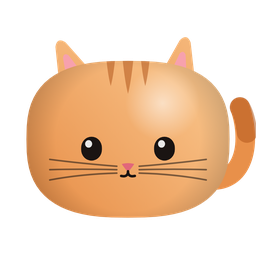
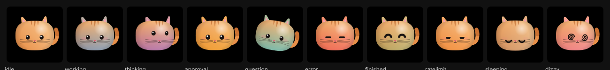

<div align="center">



# Ronron

**A little ginger cat at the top of your Windows or Linux screen that keeps an eye on your AI coding agents.**


</div>



Ronron lives in a small island at the top of the screen. He purrs while Claude Code works, pricks up his ears when it needs your permission, and lets you **Allow / Deny**, answer questions, chat, dictate and drop files without leaving what you are doing.

- 🤖 **Your agents, live**: Claude Code, Codex, Cursor, Gemini CLI, Copilot CLI and more: what they read, edit and run, with live diffs.
- ✅ **Approve from the island**: permission requests and questions show up right away and wait for your answer.
- 💬 **Chat** with Claude through your own subscription (Claude Code) or an API key, or with Gemini, OpenAI, OpenRouter or a local model.
- 🎙️ **Flow**: hold a key, speak, let go: offline dictation with Parakeet. Plus a call **Notetaker** and « **OK Ronron** ».
- 📬 **Mail** (classic Outlook), **GitHub**, **n8n**, **Stripe**, **Vercel**, **Cal.com**, **Notion**, **Spotify**, **WhatsApp**: each gets its own mini cat pill.

The full guide (install, shortcuts, integrations, keys, building) is in **[windows/README.md](windows/README.md)**.

## Build it

```bash
cd windows
npm install
npm run tauri dev        # run it
npm run pack             # installers in windows/release/
```

Windows needs Rust, Node 22 and the WebView2 runtime. Linux needs the libraries listed in [windows/README.md](windows/README.md#linux).

Assets are generated from code, from `windows/`:

```bash
python3 scripts/gen-sounds.py   # the 29 sounds (numpy)
python3 scripts/gen-icons.py    # the app icons (needs the dev server, Chrome and Pillow)
```

## Where it comes from

Ronron is a fork of **[Coucou](https://github.com/Louis-CFM/coucou)** by Louis Raillé, under the MIT License. It keeps Coucou's Windows and Linux app, renamed, with its own character (Ronron the cat), icon and sounds. Ronron is not made or endorsed by Coucou's author. See [NOTICE.md](NOTICE.md).

## License

[MIT](LICENSE): © Louis Raillé (Coucou) and © Greg Mauceri (Ronron).
